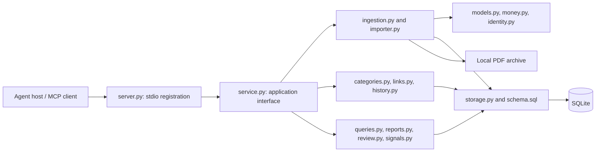
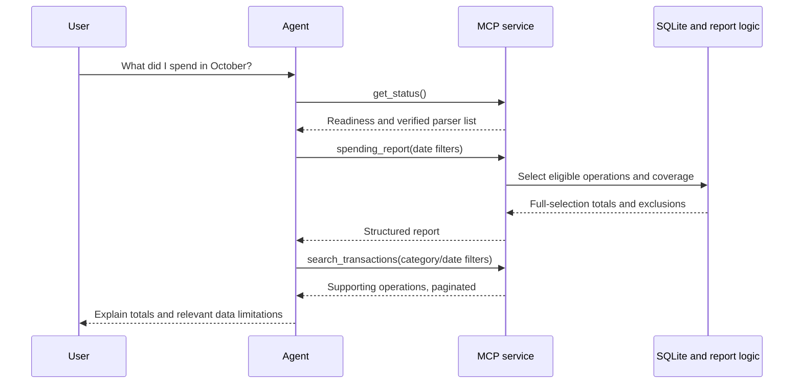

# Architecture

Finance MCP KZ is a local data-processing service exposed to an AI agent through
MCP. It has no independent chat interface or embedded model. The host agent
invokes typed tools, receives facts, and decides how to explain them to the user.

The first release targets one owner, multiple owned accounts, PDF text layers,
and KZT. Current production has no registered bank adapters. Its ledger and
transport are implemented; real Kaspi/Freedom ingestion remains a separate
verification milestone.

For orientation, see the [documentation index](docs/README.md). Detailed
[data-model](docs/data-model.md), [algorithm](docs/algorithms.md), and
[tool](docs/mcp-tools.md) references describe the contracts behind this overview.

## Components and responsibilities



| Module | Owns | Does not own |
| --- | --- | --- |
| `server.py` | CLI options, data-directory defaults, service construction, MCP tool registration | Financial formulas or bank parsing |
| `service.py` | Agent-facing method signatures, delegation, list results, source paths | MCP protocol implementation or schema migrations |
| `ingestion.py` | Allowed-root checks, PDF limits, extraction, adapter selection, archival | Category judgment or generic guessed bank parsing |
| `importer.py` | Atomic normalized imports, bank-ID reuse, source rows, duplicate reviews | Reading arbitrary files or interpreting recommendations |
| `models.py` | Bank/kind enums, immutable input dataclasses, validation, reconciliation | Database connections |
| `money.py` | Exact textual amount conversion and integer-range checks | Currency conversion |
| `identity.py` | Conservative text normalization and transaction fingerprints | Proof that two fingerprint matches are duplicates |
| `storage.py`, `schema.sql` | Connections, SQL records, schema initialization and version check | A migration framework or an ORM |
| `categories.py` | Category records, rule matching, previews, explicit/manual assignments | Merchant web lookup or ML classification |
| `links.py` | Pair validation, automatic reliable transfer matching, duplicate decisions | Arbitrary graph merging |
| `history.py` | Decision snapshots and conflict-checked undo | Replaying or deleting imported facts |
| `queries.py` | Shared ledger projection, filters, pagination, provenance lookup | Spending explanations |
| `reports.py` | Exact spending/income summaries and period deltas | Budgets, forecasts, or financial advice |
| `review.py` | Stored review queue, unknown-merchant groups, transfer suggestions | Automatically accepting ambiguous pairs |
| `signals.py` | Explainable ranking and recurrence heuristics | Fraud classification or cancellation advice |

`__main__.py` is the module entry point. `__init__.py` marks the package.
`py.typed` and packaged SQL resources support typed installation outside a checkout.

The domain functions can be called directly in tests without an MCP server.
MCP integration is a wrapper around application behavior, not a second
implementation of accounting rules.

## Data flow

```text
MCP client -> typed service methods -> domain functions -> SQLite
                                      |
PDF path -> allowed-root check -> SHA-256 -> text extraction
                                      |
                             verified bank adapter
                                      |
                         validated StatementInput
                                      |
                     atomic import and source records
```

The bank-adapter slot is intentionally empty until Kaspi and Freedom statement
formats have been inspected. There is no generic parser pretending to support them.
Tests inject a synthetic adapter; production never registers it.

### Startup and lifetime

The CLI resolves the data directory, creates its inbox, initializes a `Store`,
and constructs an `Ingestion` instance and `FinanceService`. `create_server`
registers bound service methods with structured output and read/write hints.
The SDK then handles MCP messaging over stdio.

No database connection stays open for the entire server lifetime. Each operation
obtains short-lived connections, making worker-thread handoff independent of
SQLite connection affinity. There is no global in-memory ledger that needs to
be restored after a restart; persisted state is in SQLite and the PDF archive.

### Example: answering a spending question



This example assumes data has already been imported through a verified adapter
or test setup. A fresh current installation has no production adapter to perform
the first bank import. The agent must not interpret an empty ledger as evidence
that the user had no spending.

## Money and identity

Money is a signed integer count of tiyn. A purchase of KZT 1,250.00 is stored as
`-125000`. Decimal separator handling is explicit; ambiguous formats are rejected.
Integer arithmetic avoids binary floating-point rounding in report calculations.

File SHA-256 identifies exact byte-for-byte reimports. Transaction identity is
separate: bank IDs are scoped to an account. Without a bank ID, a fingerprint
finds review candidates; it does not prove two purchases are identical.
Occurrences within one statement remain distinct. Confirming duplicates across
statements cannot merge two occurrences from the same statement into one.

## Storage and audit

SQLite stores accounts, statements, transactions, source rows, categories, rules,
review items, relationship links, and decision history. Source rows keep original
descriptions and page numbers; statement hashes locate archived PDFs.
The database schema version is checked on startup. Unknown versions fail rather
than being silently modified.

Each operation opens and closes its own connection. Write workflows that inspect
and modify shared state use a transaction. Imports roll back completely on failure.
Batch folder imports report file errors independently. Archived bytes may remain
unreferenced if a database import fails after archival; they are not transactions.

Category assignments, rule changes, and links record before/after snapshots in
the same transaction. Undo checks current state before restoring snapshots.
Later edits or foreign-key dependencies prevent an unsafe undo.
Importing source facts is not itself reversible through the decision-history tool.

## Categorization

Categories are agent-created records, with one reserved system category:
`Uncategorized`. Merchant normalization changes only case and whitespace.
It preserves digits and punctuation to avoid merging unrelated companies.

Rules match exact normalized merchants, optionally constrained by account and
debit/credit direction. Manual assignments win. Different matching categories
create a conflict; rule order never decides the category.

Batch previews include a hash of the current selection and requested decision.
The apply call recomputes it within a write transaction. A changed selection or
decision invalidates the token. Tokens establish a reviewed batch, not user identity.

## Reports

Search includes all stored operations and eligibility flags. Ordinary reports
exclude confirmed duplicate copies, unresolved duplicate candidates, and operations
without a source from a nonfailed statement. Both `passed` and `unavailable`
sources can establish eligibility. Missing checks are reported as unavailable,
not passed; eligibility does not certify a successful balance reconciliation.

Confirmed internal transfers do not count as income or spending. Automatic linking
requires unique same-day opposite amounts on two owned accounts and reciprocal
account references. Amount/date coincidence alone is only a review candidate.
Fees remain expenses; cash withdrawals are separate because subsequent cash use
is unknown. Confirmed refunds reduce the original category in the refund period.

Reports calculate over all matching eligible rows, not the visible search page.
They return source coverage and excluded counts. Coverage describes imported data;
it cannot establish that the user provided every account and statement.

## Design decisions and tradeoffs

| Decision | Reason | Cost or boundary |
| --- | --- | --- |
| Local stdio service | Agent hosts can launch one installed command; no web deployment required | No remote service, shared account system, or Telegram adapter |
| SQLite through the standard library | Persistent transactions and queryable relations without a separate database service | Serialized writes and no implemented migration framework |
| Integer tiyn | Exact deterministic money arithmetic | KZT only; text formats must be parsed deliberately |
| Adapter-produced input models | Separate PDF layout concerns from accounting and persistence | Each bank-format variant needs samples and tests |
| Original PDFs plus source rows | Results can be traced to the evidence behind them | Sensitive data and backup size remain the owner's responsibility |
| Rules rather than an internal model | Repeatable decisions without model latency, token cost, or invented labels | Unknown merchants and conflicts require agent judgment |
| Candidate exclusion before duplicate resolution | Avoid counting suspected copies as additional spending | A distinct purchase can be temporarily omitted; exclusions must be visible |
| Preview tokens | Detect changes between batch inspection and application | Extra call and potentially large previews; no authentication meaning |
| Audit snapshots | Explain current decisions and reject conflicting undo | No full event replay, import undo, or redo |
| Python report aggregation | Clear integer formulas over shared eligibility semantics | Full matching selections are materialized in memory |

These are implementation choices for the current local prototype, not claims
that the system is ready for arbitrary file sizes or multi-user hosting.

## Consistency and failure boundaries

An import is atomic in SQLite; a folder is a collection of independent imports.
File archival occurs before database persistence and is not part of the database
transaction. Expected file errors are reported per file, while unexpected
programming errors can still fail a call.

Individual search pages and reports use database read transactions. Multiple
tool calls, separate search pages, and the two reports in `compare_periods` do
not share one snapshot. For reproducible analysis, avoid importing or changing
decisions concurrently with a multi-call investigation.

Typed input models validate selected domain invariants. Many result values use
`dict[str, Any]`; structured MCP output does not imply that every output field
has an independently defined, detailed DTO schema. The tool reference documents
the result fields produced by the current code.

Known technical limits and troubleshooting procedures are documented in
[Operations](docs/operations.md), and extension requirements are in the
[Development guide](docs/development.md).

## Boundaries

The server runs locally over stdio, does not use the network, and does not call a
model. The MCP SDK's transport dependencies do not imply network use by this app.
The agent chooses interpretations and recommendations. Returned source text is
untrusted data, never instructions.

The application restricts its import tools to configured folders. This restriction
does not sandbox the host agent or prevent it from using other filesystem tools.
The application does not encrypt storage or control data retained by the agent host.
