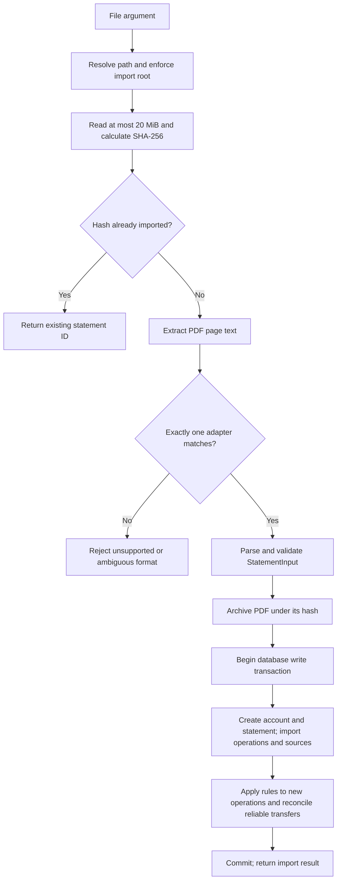

# Algorithms and accounting semantics

This document explains current behavior, including limitations that affect
interpretation. The formulas operate on integer tiyn, not floating-point tenge.
See [Data model](data-model.md) for entities and [Tools](mcp-tools.md) for calls.

## Import pipeline



The database import checks the hash again inside its write transaction. This
closes the gap between the ingestion-layer lookup and persistence.
An exception during normalized import rolls back its database changes, including
new accounts, sources, rule assignments, and automatic transfer decisions.

PDF archival happens first, using a temporary file followed by `os.replace`.
The filesystem and SQLite do not share a transaction. A failed database import
may leave an unreferenced archived PDF; it does not leave a partially imported
ledger. No archive garbage collector exists.

Folder import handles direct PDF children in sorted path order. It reports
`OSError` and `ValueError` failures separately per file; unexpected programming
errors are not broadly swallowed. An empty folder produces an empty result.

## Money conversion and input validation

`parse_kzt` accepts an optional leading sign, digits with optional properly grouped
spaces, and zero to two fractional digits after a comma or period. Nonbreaking
spaces and narrow nonbreaking spaces are normalized to ordinary spaces.

| Text | Stored tiyn |
| --- | ---: |
| `1 234,56` | 123456 |
| `-1 250.00` | -125000 |
| `+12` | 1200 |
| `-0.01` | -1 |

`1,234.56`, `1 23`, `1.001`, `NaN`, and exponent notation are rejected. A parser
must remove format-specific currency labels deliberately; the amount helper
does not guess them. Values must fit the signed SQLite 64-bit integer range.
The amount helper can return zero, but a transaction model rejects a zero amount.

Transaction kinds constrain signs: purchases, fees, and cash are negative;
income and refunds are positive; transfers may be either sign. All transaction
dates must fall within the statement's inclusive period. Only `KZT` is accepted.

## Reconciliation

The parser may provide any combination of balance and turnover controls.
For transaction amounts `a[i]`, the available checks are:

```text
opening balance + sum(a[i]) == closing balance
-sum(a[i] where a[i] < 0)   == statement debit total
 sum(a[i] where a[i] > 0)   == statement credit total
```

| Status | Meaning | Reporting consequence |
| --- | --- | --- |
| `passed` | At least one check exists and all available checks agree | Sources can establish eligibility |
| `failed` | At least one available check disagrees | Sources cannot establish eligibility |
| `unavailable` | No complete check can be performed | Sources can establish eligibility, with the status visible |

A failed statement is stored for inspection rather than discarded. There is
currently no tool to override or repair its reconciliation status. A transaction
may still qualify through another nonfailed source, including an active confirmed
duplicate's source. None of these statuses prove the user supplied every statement.

## Deduplication

### Exact file identity

The SHA-256 of original PDF bytes prevents importing the exact same file twice.
Renaming the file does not change the hash. A different export or a PDF with
changed metadata can have a different hash even if its operations are identical.
File identity therefore cannot replace transaction identity.

### Bank identifiers

Within an account, a known `bank_id` reuses the existing transaction when its
fingerprint agrees. The import adds another source reference and preserves the
transaction's existing category. A conflicting fingerprint aborts the import;
the server does not guess which version is correct.

Repeating one bank ID twice in the same statement also aborts the import.
Different non-null IDs are treated as different operations, even if their amounts
and descriptions match. IDs at different accounts are independent.

### Fingerprint candidates

The fingerprint is SHA-256 over compact JSON containing, in order:

1. ISO posting date.
2. Signed tiyn amount.
3. Normalized description.
4. Normalized merchant.
5. Transaction kind.
6. Counterparty account, including null when absent.

Normalization collapses whitespace and uses Python `casefold`. It preserves
punctuation and digits. Page number, PDF hash, category, and source ordinal are
not fingerprint inputs. Account scope is enforced by the lookup query.

When a new transaction matches an operation from an earlier statement and at
least one of the bank IDs is absent, the server creates a duplicate review.
Identical rows newly created within the same statement do not trigger each
other's reviews. Matching does not require the declared statement periods to
overlap; the operation's date is already part of the fingerprint.

Both records remain stored. The new candidate is excluded from ordinary totals
until the agent confirms a duplicate or keeps it separate. This can temporarily
understate spending if the candidate is a distinct real purchase. The excluded
count is therefore part of every report's interpretation.

### Confirming a duplicate

The left operation becomes canonical; the right remains stored as a copy.
Confirmation requires the same account and fingerprint, no contradictory bank
IDs, and compatible existing relationships. Source-statement sets must be
disjoint, including sources already attached through canonical duplicate links.

For example, two identical purchases in PDF A and two in PDF B cannot all be
merged into one operation. Once one B occurrence is linked to the first A
operation, linking the second B occurrence to that same canonical operation is
rejected. Duplicate chains are also rejected.

The canonical detail view includes copy sources. A copy's categories are not
transferred to the canonical operation. Resolving a review as `keep_separate`
instead admits the candidate to reports, provided its sources are otherwise valid.
Both decisions can be undone through history.

## Categorization

A new operation starts at category `1`, `Uncategorized`. Active rules match an
exact normalized merchant and optional account and direction restrictions.

| Matching result | Assignment |
| --- | --- |
| Manual assignment already exists | Preserve it without applying rules |
| No matching rule | `Uncategorized`, assignment `none`, no rule ID |
| All matching rules choose one category | Assign that category; store the lowest matching rule ID as explanation |
| Matching rules choose different categories | `Uncategorized`, assignment `none`, and a rule-conflict review |

There is no specificity precedence: a scoped rule does not automatically override
an unscoped rule. Multiple rules choosing the same category are not a conflict.

New imports run these rules for newly created transactions only. Existing
transactions require an explicit `manage_rules(action="apply")` workflow.
That workflow considers all nonmanual transactions, including ones currently
excluded from reports. Disabling a rule changes future matching but does not
immediately reset previously assigned categories. Reapplying rules does.

Manual assignment resolves an open rule-conflict review for that operation.
The conflicting rules themselves remain active, so future operations may still
require review until the rules are corrected or disabled.

### Preview and apply

The first assignment call returns selected IDs, count, signed amount, and a token.
It does not change category state. The apply call repeats the operation with
the token. Inside a write transaction, the server recalculates the checksum and
rejects it if the relevant state changed.

Assignment previews cover the category record and complete selected transaction
records. Rule-application previews cover all rules, including inactive rules,
and all selected nonmanual transaction records. Rule previews describe the
selection to reconsider, not a per-operation table of predicted final categories.

Tokens do not expire by elapsed time, are not consumed, and are not secrets.
They are state checks, not authentication or proof that a human approved a change.

## Transfers and refunds

Manual transfer confirmation requires two `transfer` operations: a debit first,
an equal credit second, different owned accounts, and dates at most three days
apart. Fees must be separate operations. Matching an amount and date alone does
not automatically confirm anything.

Automatic transfer matching runs at the end of an import and is stricter:

- Same posting date and exactly opposite amounts.
- Reciprocal account references identify the two owned accounts.
- Exactly one candidate for each endpoint in the candidate set.
- Neither endpoint has an existing active relationship or an unresolved duplicate review.
- Each endpoint has a direct source from a nonfailed statement.

A refund links a purchase debit to a refund credit on the same account, on or
after the purchase date. Several partial refunds are allowed, but their combined
amount cannot exceed the purchase. One refund credit cannot be reused in a
second active relationship. Compatible pair checks also prevent mixing an
operation into unrelated transfer or duplicate roles.

## Report eligibility and calculations

`queries.py` constructs a computed SQL `ledger` CTE; it is not a persisted table.
For each transaction it derives:

| Field | Definition |
| --- | --- |
| `effective_category_id` | Original purchase's current category for a linked refund; otherwise the stored category |
| `internal_transfer` | An active transfer link includes this operation |
| `linked_refund` | This operation is the right side of an active refund link |
| `valid_source` | A direct source or confirmed-copy source belongs to a nonfailed statement |
| `confirmed_duplicate` | This operation is the right side of an active duplicate link |
| `pending_duplicate` | An unresolved duplicate review exists for this operation |
| `report_eligible` | `valid_source` and neither confirmed nor pending duplicate |

Search returns all matching operations with these flags. Reports use only
eligible operations. A rule-category conflict does not exclude spending; it
remains in `Uncategorized`.

For each eligible transaction, its spending contribution is:

```text
0                  for a confirmed internal transfer or cash withdrawal
-amount_tiyn       for any other debit
-amount_tiyn       for a linked refund credit
0                  for other credits
```

Consequently, unconfirmed outbound transfers count as spending. Confirmed
refunds reduce net spending, and a category can have negative spending in a
refund-only month. The original purchase is not moved to the refund month.

Other report fields:

- Income: positive amounts except refunds and confirmed internal transfers.
- Cash withdrawals: magnitude of `cash` debits, separate from spending.
- Fees: magnitude of `fee` debits; also included in spending, not additive to it.
- Unlinked refunds: positive refund amounts without confirmed purchase links.
- Category groups: sum spending contributions by effective category.
- Merchant groups: sum by each transaction's own normalized merchant. A refund's
  merchant is not rewritten to the purchase merchant.

Category and merchant rows are sorted by descending net amount. Zero-contribution
operations create no groups; offsetting contributions can leave a zero-total group.
`transaction_count` counts eligible selected operations, including those with
zero spending contribution. Report aggregates are computed in Python over the
entire selected result, not the current search page.

### Worked example

Assume all records are eligible and relationships have been confirmed as shown:

| Operation | Amount in KZT | Category | Spending contribution in KZT |
| --- | ---: | --- | ---: |
| Salary | +300,000 | Income | 0 |
| Groceries | -20,000 | Food | +20,000 |
| Transfer to owned account | -50,000 | Transfers | 0 |
| Matching owned-account credit | +50,000 | Transfers | 0 |
| ATM withdrawal | -10,000 | Uncategorized | 0 |
| Bank fee | -500 | Fees | +500 |
| Linked grocery refund | +5,000 | Effective category: Food | -5,000 |

The report has KZT 15,500 net spending, KZT 300,000 income, KZT 10,000 cash
withdrawals, and KZT 500 fees. The fee is already inside net spending.
If the refund arrives next month, this month's spending stays KZT 20,500 and
next month's Food contribution includes KZT -5,000.

### Coverage and period comparison

Coverage lists imported statements overlapping the requested dates and matching
bank/account filters. Category, merchant, and amount filters do not reduce this
source-coverage list. Coverage does not detect missing accounts or certify
continuous date coverage.

Period comparison produces two reports and exact `current - previous` deltas
for spending, categories, and merchants. Groups absent in one period count as
zero. Contributions are ordered by absolute delta, then group identity.
The tool does not normalize different period lengths or calculate percentages.
The two reports are separate read transactions, not one shared database snapshot.

## Review signals

Signals require a start date. Historical data precedes that date and is scoped
to the requested bank/account; the selected current period uses all its filters.

- Largest expenses: up to 20 current transactions with positive spending contributions.
- New merchants: up to 20 alphabetically sorted current expense merchants absent
  from imported expense history. No prior data makes every current merchant new.
- Recurring candidates: group eligible expenses from history and the current
  selection by account, merchant, and exact signed amount. Require at least three
  occurrences and every adjacent date gap between 25 and 35 days, inclusive.
  Return supporting IDs and gaps, capped at 20 groups.

This recurrence heuristic does not support weekly payments, variable-price
subscriptions, missing months, or same-day duplicates within the group. Historical
recurring groups can be returned even without a current-period occurrence.
Signals do not establish fraud, waste, or a recommendation to cancel anything.

## History and undo

The journal records changes to categories, rules, transaction assignments, links,
and review resolution in the same database transaction as the decision.
Undo applies patches in reverse order only when current rows exactly match their
recorded `after` snapshots. Foreign-key dependencies can also block restoration.

Undo marks the original change as undone and creates an `undo:<id>` audit entry.
That entry cannot itself be undone; there is no redo tool. The history API does
not remove imported statement facts, delete archives, or replay the database.
For a blocked undo, inspect history and reverse dependent decisions first.
