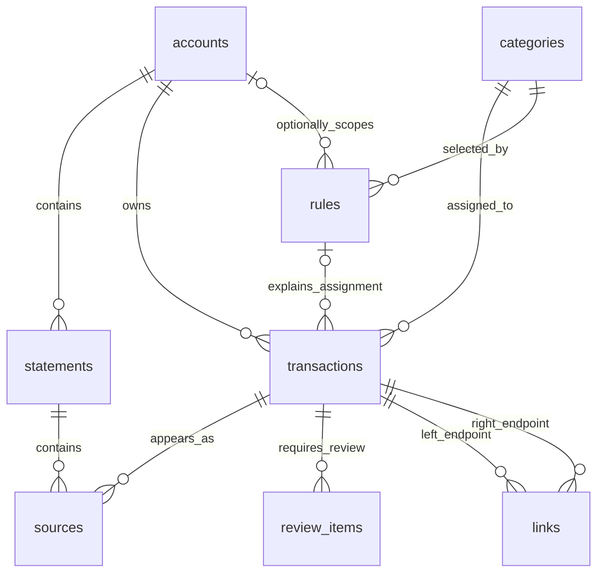

# Data model and persistence

See [Architecture](../ARCHITECTURE.md) for request flow and
[Algorithms](algorithms.md) for the business meaning of these records.
The executable DDL is [schema.sql](../src/finance_mcp/schema.sql).

## Storage conventions

- Schema version: `PRAGMA user_version = 1`.
- Identifiers: SQLite-generated integer primary keys, local to one database.
- Currency: `KZT`; money is a signed 64-bit integer count of tiyn.
- Transaction and statement dates: ISO `YYYY-MM-DD` text, with date-only precision.
- Boolean flags: SQLite integers `0` and `1`.
- Structured review details and audit patches: JSON stored as text.
- Audit creation time: SQLite `CURRENT_TIMESTAMP`, in UTC.

Account references, merchant descriptions, PDF text, and decision history can
contain personal information. They are application data, not development logs.
The database is not encrypted by the application.

## Entity relationships

`changes` is an audit table containing snapshots of several entity types. Its
JSON entity references are not database foreign keys, so it is omitted from
the relational diagram.

## `accounts`

An account is an owned bank account observed in imported data.

| Field | Meaning |
| --- | --- |
| `id` | Local account identifier |
| `bank` | Bank identifier; current domain enum values are `kaspi` and `freedom` |
| `reference` | Account identity supplied by the parser |
| `currency` | Always `KZT`, enforced by a database check |

`(bank, reference)` is unique. The same transaction ID at a different account
does not refer to the same transaction. Account references also participate in
reciprocal transfer matching, so a future parser must extract them consistently.
The current tools do not create or rename accounts independently of imports.

## `statements`

One record represents one distinct imported PDF, not a monthly aggregate.

| Field | Meaning |
| --- | --- |
| `id` | Local statement identifier |
| `sha256` | Unique SHA-256 of the original PDF bytes |
| `account_id` | Owning account |
| `start`, `end` | Inclusive period reported by the parser |
| `parser_version` | Adapter version used for this import |
| `reconciliation` | `passed`, `failed`, or `unavailable` |
| `opening_tiyn`, `closing_tiyn` | Optional signed balances |
| `debits_tiyn`, `credits_tiyn` | Optional nonnegative turnover totals |

The archived PDF is located at `<data-dir>/statements/<sha256>.pdf`; the path
is derived rather than stored. A new PDF with an overlapping period can create
a new statement even when all of its transactions already exist.

Parser changes do not automatically reprocess previously imported file hashes.
There is currently no reparse or statement-delete tool.

## `transactions`

Transactions contain normalized economic facts and current categorization state.

| Field | Meaning |
| --- | --- |
| `id`, `account_id` | Local identity and owning account |
| `posted_on` | Posting date, with no fabricated timestamp |
| `amount_tiyn` | Nonzero signed amount: debit negative, credit positive |
| `description` | Parser-provided description, preserved before merchant normalization |
| `merchant` | Whitespace-normalized, case-folded merchant |
| `kind` | `purchase`, `income`, `transfer`, `refund`, `fee`, or `cash` |
| `bank_id` | Optional transaction identifier from the bank |
| `counterparty_account` | Optional opposite account reference |
| `fingerprint` | Hash of normalized identity fields |
| `category_id` | Current explicit category; defaults to system ID `1` |
| `assignment` | `none`, `rule`, or `manual` |
| `rule_id` | Rule chosen to explain a rule-based assignment, otherwise null |

`(account_id, bank_id)` is unique for non-null bank IDs. SQLite permits multiple
null IDs, which is necessary for statements without identifiers and for two real
identical purchases. The fingerprint is indexed, not unique.

Python input models validate signs and money ranges. The SQL table enforces
nonzero amounts and selected invariants, but does not duplicate every Python
validation. Direct SQL writes are not a supported import interface.

Each transaction has one stored category. Category hierarchies, transaction
splits across several categories, custom tags, exchange rates, and time-of-day
fields are not represented by the current schema. A linked refund's effective
category is computed at query time rather than replacing its stored category.

## `sources`

Sources separate an operation from each appearance of it in a PDF.

| Field | Meaning |
| --- | --- |
| `statement_id` | Source statement |
| `ordinal` | Zero-based position in the parser's transaction sequence |
| `transaction_id` | Operation represented by this occurrence |
| `page` | One-based page number |
| `raw_text` | The input transaction description saved with the occurrence |

Primary key: `(statement_id, ordinal)`. A second unique constraint on
`(statement_id, transaction_id)` prevents one bank-ID operation appearing twice
inside the same imported statement.

One transaction can have many sources after overlapping imports. Confirming a
duplicate does not rewrite or delete either transaction's source rows. Instead,
the canonical transaction's detail query includes sources of its active duplicate
copies. Querying a copy does not perform a reverse canonical-source expansion.

## `categories` and `rules`

`categories` contains `id` and a unique `name` using SQLite `NOCASE` collation.
This is SQLite's collation behavior, not a custom Unicode name-normalization
algorithm. ID `1`, named `Uncategorized`, is inserted during initialization and
cannot be renamed through the category tool.

| Rule field | Meaning |
| --- | --- |
| `id` | Rule identifier |
| `merchant` | Exact normalized merchant to match |
| `category_id` | Category to assign |
| `account_id` | Optional account restriction; null matches all accounts |
| `direction` | Optional `debit` or `credit` restriction |
| `active` | Whether the rule participates in matching |

Rules have no priority, regular expressions, or fuzzy matching. Multiple rules
may exist for the same merchant. Conflict resolution uses their category IDs,
as described in [Algorithms](algorithms.md#categorization).
Disabling a rule retains its record and existing assignment references.

## `review_items`

| Field | Meaning |
| --- | --- |
| `id` | Review identifier |
| `kind` | Currently generated as `duplicate` or `rule_conflict` |
| `transaction_id` | Operation requiring a decision |
| `details` | JSON: duplicate `candidate_ids` or conflicting `rule_ids` |
| `resolved` | Whether the stored review has been addressed |

`(kind, transaction_id)` is unique. Existing rule-conflict records can be updated
and reopened during reclassification. They are not deleted on resolution.
Unknown-merchant groups and transfer candidates are calculated views returned by
the review tool; they are not rows in this table.

## `links`

| Field | Meaning |
| --- | --- |
| `id` | Relationship identifier |
| `kind` | `transfer`, `refund`, or `duplicate` |
| `left_id`, `right_id` | Two different transaction IDs |
| `active` | Whether the relationship participates in current calculations |

Endpoint order is significant:

| Kind | Left | Right |
| --- | --- | --- |
| `transfer` | Debit on one owned account | Credit on another owned account |
| `refund` | Original purchase debit | Refund credit on the same account |
| `duplicate` | Canonical transaction | Copy excluded from reporting |

Additional compatibility, multiplicity, and amount checks happen in `links.py`.
They are application invariants rather than a complete set of SQL constraints.

## `changes`

| Field | Meaning |
| --- | --- |
| `id` | Identifier returned as `change_id` by decision tools |
| `action` | Label such as `category:assign`, `rule:apply`, or `link:refund` |
| `patches` | JSON list of entity snapshots |
| `created_at` | UTC creation time |
| `undone` | Whether the original change has been successfully undone |

Each patch contains `table`, `id`, `before`, and `after`. A created entity has
`before: null`. No-op updates do not create patches, and an empty journal returns
`change_id: null`. History is an audit mechanism, not event-sourced storage from
which the entire database can be rebuilt.

## Connection and schema lifecycle

`Store` creates the database directory and initializes version-zero databases
from the packaged SQL resource. Version one is accepted as-is. Other versions
are rejected. There is no migration runner, schema-repair procedure, or downgrade.

Each service operation opens a connection with foreign keys enabled and a
30-second SQLite lock timeout. Connections commit on success, roll back on
failure, and close. No connection is shared across MCP worker threads.
Several read-modify-write workflows use `BEGIN IMMEDIATE`; paginated reads and
individual reports use explicit read transactions. The application does not
enable WAL or provide a multi-process task queue.

Indexes support transaction period/account lookup, fingerprint lookup within an
account, and source lookup by transaction. Reports still materialize their full
eligible selection in Python; these indexes are not a scalability guarantee.
